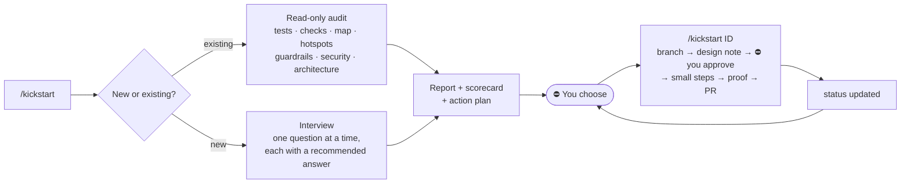

<div align="center">

# unvibe

### Your AI agent writes code fast. Let's make sure it's code you can still change next year.

**One command turns a vibe-coded repo into a codebase AI agents can be trusted with.**

`/kickstart` · audit → scorecard → action plan → fixes, one safe step at a time

</div>

---

## Sound familiar?

- The agent says **"Done! ✅"**, and the app doesn't even start.
- You asked for a button and got a button, plus a "helpful" refactor of three files you didn't mention.
- The same bug comes back after you fixed it twice.
- Your frontend says *refund*, your database says *reversal*, your emails say *chargeback*, and the agent invents a fourth word.
- You're scared to touch parts of your own project, because you don't really know what's in there anymore.
- Your `CLAUDE.md` is 400 lines of **IMPORTANT!!!** and the agent still ignores half of it.

None of this means the model is dumb. **AI is brilliant at tactical work: solving today's task. Nobody trained it to care whether your codebase is still easy to change nine months from now.** Every shortcut makes the environment worse, and the codebase *is* the agent's environment. So the next session gets worse too.

The fix isn't a smarter model or a longer prompt. **It's a better environment.**

## Meet `/kickstart`

`unvibe` gives your coding agent one skill. Point it at any repo, new or old, tidy or total spaghetti, and type:

```
/kickstart
```

It reads your whole project **without changing a single line** and hands you:

- a **scorecard** across 9 dimensions;
- a **prioritised action plan**, where every item comes with evidence from *your* code.

Then you pick what to fix. It fixes **one thing per session**, proves it works, and opens a PR you can actually review.

```
/kickstart          → audit + scorecard + action plan     (read-only, changes nothing)
/kickstart S1       → fix action item S1 on its own branch, with proof
/kickstart status   → what's done, what's next
/kickstart workflow → how to work day-to-day in this repo from now on
/kickstart again    → re-audit and compare with last time
```

## See it in action

We ran `/kickstart` on a tiny, deliberately sloppy webshop. It has 3 Python files and 1 test, and a few landmines: an API key committed to git, a debug endpoint left open, duplicated business logic, and a "fix" that got reverted. Here's what the agent replied (only re-wrapped to fit):

```text
> /kickstart

Kickstart audit: demo-shop @ 4a60203 (existing project)

Scorecard (0 to 3): Tests 1 · Types/lint 0 · Agent verification 1 · Harness 0 ·
Shared language 0 · Architecture 1 · Review/PR 0 · Security 0 · CI/branch protection 0

The one test passes (python -m pytest, 0.03 s), but nothing tests the discount,
refunds or the API. The discount logic exists twice in orders.py, and the only
fix so far was reverted. Refund, chargeback and "reversed" are three names for
the same thing.

Top 5 action items:
1. S1: .env is committed (since c3be5fc) and not in .gitignore. Rotate its
   secrets, stop tracking it and add it to .gitignore. Rewriting git history is
   a separate, one-way decision. (S)
2. S2: /debug returns the whole order database without authorization
   (api.py:7-9). Remove it or protect it. (S)
3. S3: /chargeback lets anyone reverse any order and does not validate the id
   (api.py:5-6). Depends on F1. (M)
4. F1: Add a pyproject.toml and tests for the discount threshold, refunds and
   the API routes. (S)
5. V1: Add a CLI driver with seed data that prints JSON, so an agent can show
   evidence its change works. Depends on F1. (S)

Full report and all 12 IDs: docs/agents/audit-2026-11-27.md

Which action items may I carry out? I'll also need a few answers. Does .env
hold real credentials? Is the discount 10 % or 15 %? Who may trigger a
chargeback? Which git host will this repo use?

Next step: /kickstart <ID> (suggested: /kickstart S1)
```

Notice what it did *not* do: it didn't touch a single file outside `docs/agents/`, and it didn't open `.env`. It also didn't guess the business rule. It asked whether the discount should be 10 % or 15 %, because it spotted the reverted fix in git history.

The full report it wrote is in [`docs/example-report.md`](docs/example-report.md). It includes:
- call-stack traces with `file:line` references;
- a domain glossary seed;
- the action list with dependencies between items.

## How it works



### Step 1: the audit (read-only)

On an **existing project**, the agent works through this list in order. It may run your tests and start your app, but it edits nothing.

| # | It checks | Why it matters |
|---|---|---|
| 1 | **Runs your tests first** | A test suite you can't run is the first thing to fix |
| 2 | Build, typecheck, lint, CI | Can mistakes be caught automatically, or only by you? |
| 3 | **Can an agent start and drive your app?** | If it can't verify its own work, *you* are the bottleneck |
| 4 | Maps the codebase **without knowing your next task** | An agent that knows the goal bends the facts toward its first idea |
| 5 | Git hotspots and reverts | Where things keep breaking, and why |
| 6 | Guardrails: CI, hooks, branch protection, agent config | What's enforced, and what's just hoped for |
| 7 | Security quick-scan | Leaked secrets, open endpoints, missing authorization |
| 8 | Architecture smells | God files, duplication, shallow modules, cycles |

On a **new project**, it interviews you instead. You'll get questions like *"Who is this for, and what's the smallest version that's useful? My recommendation: …"*. Most of the time you only need to answer "yes".

### Step 2: the action plan

Every item gets an ID, an estimated size, its **door** (two-way = easy to undo, one-way = not) and its **blast radius**. Items run in a deliberate order:

| | Block | What it gives you | Example item |
|---|---|---|---|
| **S** | Security-urgent | No leaked keys, no open doors | *Rotate the key committed in `c3be5fc`, untrack `.env`* |
| **F** | Foundation | One command each for test, typecheck, lint; CI that fails on errors | *Characterisation tests for checkout and refunds* |
| **V** | Verification | The agent can **launch, drive and screenshot** your app itself | *A `verify` script: start → click through checkout → save evidence* |
| **H** | Harness | The agent **can't say "done"** while checks fail | *Stop hook running typecheck; deny rule on `.env`* |
| **T** | Language and knowledge | One word per concept, decisions written down | *`GLOSSARY.md`: refund ✔ · reversal ✘ · chargeback ✘* |
| **R** | Ratchet checks | Mistakes that happened twice become impossible | *Lint rule whose error message tells the agent the fix* |
| **Re** | Review setup | A fresh, read-only reviewer plus an always-on security pass | *`reviewer` agent and a PR template with evidence* |
| **A** | Architecture | Big, testable modules instead of scattered logic | *Merge the two copies of the discount rule into one module* |
| **Au** | Autonomy | Scheduled jobs, auto-merge | ***Only if you explicitly decide so. Never a default.*** |

### Step 3: fixing, one item per session

```
/kickstart F1
```

1. Creates a branch. If `F1` depends on something unfinished, it tells you.
2. If the change isn't trivial, it writes a **one-page design note** and **stops for you to read it**. It's a page, not a 40-page plan.
3. Implements in small steps.
4. **Proves new checks actually bite:** they pass, then fail on a planted violation, then pass again after the revert.
5. Opens a PR with **evidence** (the test that failed and now passes, a screenshot, real output) and a **merge danger** line.
6. Updates `docs/agents/kickstart-status.md`, so the next session knows where you are.

## What changes in your repo: before and after

*Illustrative examples of the kind of changes `/kickstart` proposes. Yours will be based on your own code.*

**A `CLAUDE.md` the agent actually follows**

<table>
<tr><th>Before</th><th>After</th></tr>
<tr><td>

```markdown
# PROJECT RULES!!!
IMPORTANT: ALWAYS write clean code
IMPORTANT: NEVER use any
The project is a React app with
src/components, src/hooks, src/utils...
(380 more lines)
```

</td><td>

```markdown
## Commands
- Test: `pnpm test` · One file: `pnpm vitest <path>`
- Typecheck: `pnpm tsc --noEmit`
## Misleading spots
- `legacy/` uses the old fetch wrapper; use `core/http`
## Knowledge
- `docs/solutions/`: solved problems by category
```

</td></tr>
</table>

Rules that keep getting ignored don't get more CAPITALS. They become **checks**.

**A lint error that teaches the agent the fix**

```
✘ no-console-in-app  src/checkout/pay.ts:42
  Use logger.track() from lib/telemetry instead of console.log —
  it attaches the order ID and is stripped in tests.
```

The agent reads the message and fixes the line itself. No human comment needed, ever again.

**"Done" now means done**

```json
{
  "hooks": {
    "Stop": [{ "hooks": [{ "type": "command", "command": "npm run typecheck 1>&2 || exit 2" }] }]
  },
  "permissions": { "deny": ["Read(./.env)", "Read(./.env.*)"] }
}
```

While the typecheck fails, the agent can't end its turn. It has to fix the errors first. *(It's a proposal: `/kickstart` shows you the diff and you approve it.)*

**PRs that tell you how careful to be**

```markdown
## Evidence
Before: POST /chargeback with another user's order → 200 OK
After:  → 403, test_chargeback_requires_owner (red → green)
## Merge danger
- Door: two-way
- Blast radius: refunds
```

Two-way door with a small blast radius? Skim it. One-way door? Read it slowly.

## Safety first

- 🔒 **The audit never modifies anything.** It changes no code or config, installs nothing, commits nothing and pushes nothing.
- 🧾 **Config is always proposed as a diff first.** That covers hooks, permissions, CI and lint rules.
- 🙈 **Secrets stay secret.** `.env` and key files are never opened; it only checks whether they're ignored or leaked in git history.
- ✋ **You stay in charge.** It stops at every decision point, and autonomy is something *you* unlock, never a default.
- 🌍 **It speaks your language.** Ask in Dutch, Spanish or Japanese, and the reports come back in that language.

## Install (1 minute)

Works with any agent that supports `SKILL.md` skills, such as [Claude Code](https://code.claude.com).

**macOS / Linux**
```bash
git clone https://github.com/dentoverhoed/unvibe.git
mkdir -p ~/.claude/skills && cp -r unvibe/skills/kickstart ~/.claude/skills/
```

**Windows (PowerShell)**
```powershell
git clone https://github.com/dentoverhoed/unvibe.git
New-Item -ItemType Directory -Force "$HOME\.claude\skills" | Out-Null
Copy-Item -Recurse unvibe\skills\kickstart "$HOME\.claude\skills\"
```

**Just one project?** Copy `skills/kickstart` into that repo's `.claude/skills/` instead.

Then open any repo in a new session and type **`/kickstart`**.

## FAQ

**Will it rewrite my project?**
No. The audit is read-only. After that it changes exactly one thing per session, only the things you picked, and always through a branch and a PR.

**Does it work on a messy, vibe-coded project?**
That's exactly what it's for. The messier the repo, the more useful the first report.

**I'm not a "real" developer. Is this for me?**
Yes. You don't need to know what a "ratchet check" is up front: every item explains what it does and why, using evidence from your own code. Ask *"what does this mean?"* at any point.

**Which languages and stacks?**
Any. It derives commands from your repo (package.json, pyproject, Makefile, CI) instead of assuming tools.

**Does it cost a lot of tokens?**
The procedure lives in the skill folder and is only loaded when you run `/kickstart`. Your normal sessions don't pay for it. An audit is one session.

**What's the catch?**
The security scan is a smoke test, not a pentest. Hooks target Claude Code's format, and other agents need their own equivalent. On Windows, Claude Code hooks run through Git Bash, so test them on your machines.

## Standing on the shoulders of giants

`/kickstart` doesn't invent a methodology. It packages what the people shipping the most with AI agents have converged on, and picks one option where they disagree. It isn't affiliated with or endorsed by any of them. Go read their work, it's excellent.

| Idea | From |
|---|---|
| Tactical vs strategic programming, deep modules | John Ousterhout, *A Philosophy of Software Design* |
| Grill before you build, shared glossary + ADRs, PRs with merge danger | Matt Pocock: [mattpocock/skills](https://github.com/mattpocock/skills), [aihero.dev](https://www.aihero.dev) |
| Task-blind research, short design notes instead of long plans | Dex Horthy / HumanLayer: [advanced context engineering](https://github.com/humanlayer/advanced-context-engineering-for-coding-agents), ["No Vibes Allowed"](https://www.youtube.com/watch?v=rmvDxxNubIg) |
| Build verification first; the enforcement ladder | Lauren Tan (@poteto): ["All Code Is Slop (Except Mine)"](https://www.youtube.com/watch?v=O_zcc6Xl12g) |
| Compound engineering: every fix makes the next one easier | Kieran Klaassen / Every: [compound engineering](https://every.to/p/compound-engineering) |
| "First run the tests", red/green TDD, agents testing by hand | Simon Willison: [Agentic Engineering Patterns](https://simonwillison.net/guides/agentic-engineering-patterns/) |
| Separate structural and behavioural commits; warning signs | Kent Beck: "Augmented Coding: Beyond the Vibes" |
| Small commits as save points | Addy Osmani: [My LLM coding workflow going into 2026](https://addyosmani.com/blog/ai-coding-workflow/) |
| Lean CLAUDE.md, hooks over emphasis, read-only reviewers | Anthropic: [Claude Code best practices](https://code.claude.com/docs/en/best-practices) |
| Error messages as "positive prompt injection" | Birgitta Böckeler: [Harness engineering](https://martinfowler.com/articles/harness-engineering.html) |

## Contributing

Tried it on your repo? We'd love to hear how it went.

- **Issues:** the stack, what `/kickstart` did, and what you expected. A concrete repro is gold.
- **PRs:** welcome for clear improvements. Please keep the runbook tight: every line costs the agent context.
- **Changed the skill?** Rebuild the demo shop with `python examples/make_demo_shop.py ../demo-shop`, run the scenarios in [`evals/`](evals/README.md), and paste the results into your PR.

If `/kickstart` saved you from a 2 a.m. "why is prod down", consider leaving a ⭐. It helps other people find it.

## License

[MIT](LICENSE). Use it, fork it, ship it.
